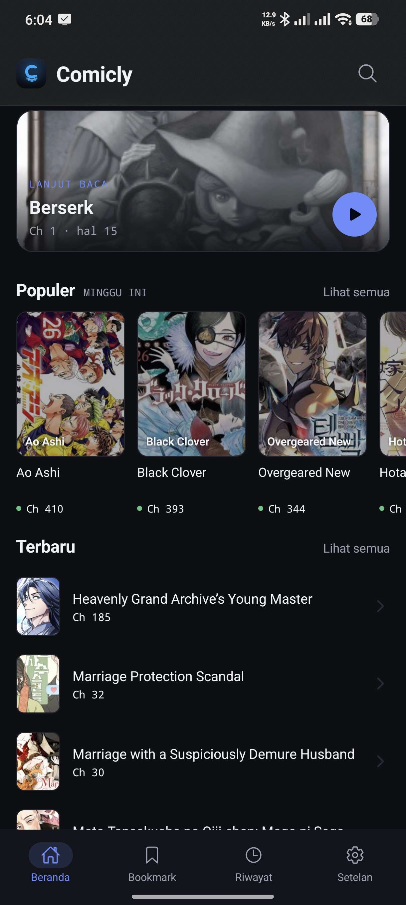
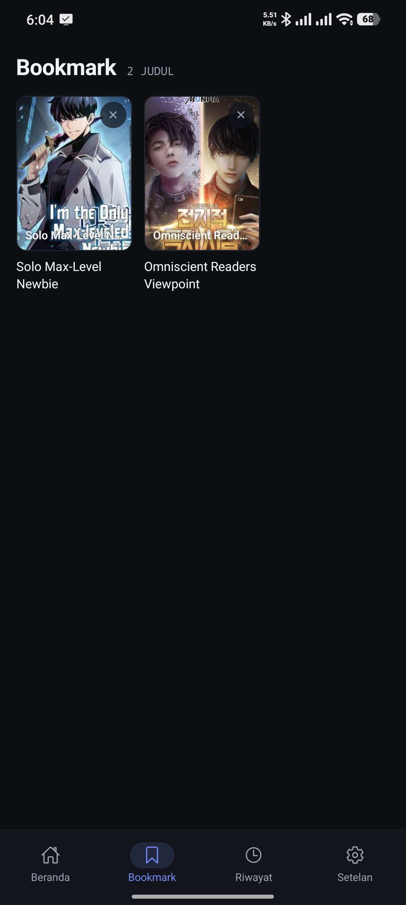
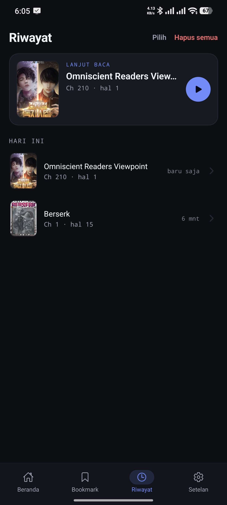
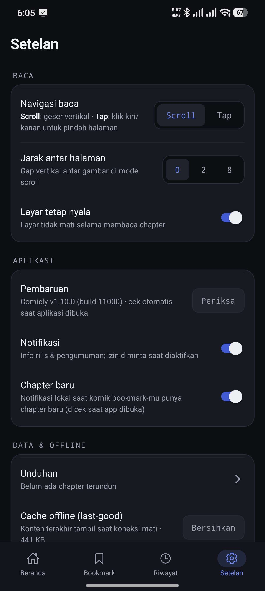

# Comicly

**Baca komik, manhwa, dan manga favoritmu di Android — tanpa akun, tanpa iklan, tanpa ribet.**

Comicly adalah pembaca komik ringan untuk Android. Katalog dibaca langsung dari sumbernya,
riwayat dan bookmark tersimpan di perangkatmu, dan aplikasi memperbarui dirinya sendiri
setiap ada versi baru.

**[⬇ Unduh APK terbaru](../../releases/latest)**

---

## Fitur

| | |
|---|---|
| 📚 **Beranda & Jelajahi** | Lanjut baca sekali ketuk, daftar populer (ratusan judul), terbaru, filter tipe (manga / manhwa / manhua), **sampai 2 genre sekaligus**, dan pencarian cepat. |
| 📖 **Pembaca yang bisa diatur** | Mode Normal / Night / Manga / Color, **Eye Comfort**, filter halaman (Paper, Warm, Sepia, Anti-silau), jarak antar halaman, navigasi **Scroll** atau **Tap**, layar tetap nyala saat membaca. |
| 🔖 **Bookmark & Riwayat** | Simpan komik favorit dan lanjutkan bacaan dari halaman terakhir — semuanya tersimpan lokal di HP. |
| ⬇️ **Unduhan offline** | Unduh chapter untuk dibaca tanpa internet, dengan progres di panel notifikasi. |
| 🔔 **Notifikasi** | Pengumuman rilis dan **notifikasi chapter baru** untuk komik yang kamu bookmark — tetap datang walau aplikasi tidak sedang dibuka. |
| 🔄 **Pembaruan otomatis** | Versi baru muncul sebagai dialog di dalam aplikasi: lihat catatan rilis, unduh, lalu pasang. APK diverifikasi sebelum dipasang. |

## Tangkapan layar

| Beranda | Bookmark |
|:--:|:--:|
|  |  |

| Riwayat | Setelan |
|:--:|:--:|
|  |  |

## Cara pasang

1. Unduh `comicly-x.y.z.apk` dari halaman [Releases](../../releases/latest).
2. Buka berkas di HP (Android 8 ke atas). Saat diminta, izinkan **"Instal aplikasi tidak dikenal"**
   untuk aplikasi File Manager/browser yang kamu pakai.
3. Selesai — pembaruan berikutnya akan ditawarkan otomatis di dalam aplikasi, tidak perlu
   mengunduh manual lagi.

> Aplikasi ini tidak tersedia di Play Store, jadi pembaruan **selalu** lewat dialog di dalam
> aplikasi. Kalau kamu memakai pengelola unduhan pihak ketiga, pastikan memasang APK-nya
> dengan aplikasi pemasang bawaan Android.

## Dukungan

Comicly **gratis, tanpa iklan, dan tanpa langganan**. Kalau aplikasi ini berguna buatmu,
kamu bisa traktir kopi untuk biaya server dan rilis berikutnya:

[☕ **trakteer.id/clynomious**](https://trakteer.id/clynomious)

## Catatan

- Katalog dan gambar berasal dari **komiku.org**. Comicly hanya pembaca — seluruh konten
  adalah milik pemiliknya masing-masing.
- Repo ini hanya menyimpan berkas rilis (APK + `manifest.json` yang dipakai pemeriksaan
  pembaruan otomatis). Kode sumber tidak dipublikasikan di sini.
